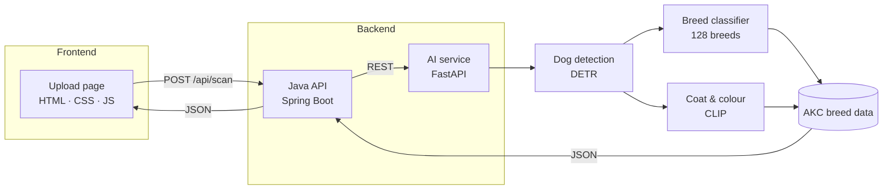

<div align="center">

# 🐾 AI Dog Scanner

**Upload one dog photo. Get its breed, coat, size, AKC standards and a diet plan.**


</div>

---

## ✨ Features

| | Feature | Details |
|---|---|---|
| 🐕 | **Breed identification** | 128 AKC breeds, top 3 matches with scores |
| 📏 | **Size varieties** | Toy, Miniature and Standard Poodle; Miniature, Standard and Giant Schnauzer |
| 🧶 | **Coat reading** | Coat type and colour from the photo |
| 📘 | **AKC breed standards** | Group, height, weight, coat, colours and temperament, with official links |
| 🍖 | **Diet plan** | Daily calories, meals per day and a feeding schedule by age and weight |
| 🛡️ | **Photo checks** | Rejects cats, people, blurry, dark and multi-dog photos |
| ❓ | **Honest results** | Says "Breed unclear" instead of guessing, and flags possible mixed breeds |
| 📄 | **Report download** | Saves the full result as a file |

## 📸 Screenshots

<table>
  <tr>
    <td align="center"><b>Results</b></td>
    <td align="center"><b>Diet plan</b></td>
    <td align="center"><b>Mobile</b></td>
  </tr>
  <tr>
    <td></td>
    <td></td>
    <td></td>
  </tr>
</table>

<sub>Screenshots show the layout using a placeholder image and test data, not a real prediction.</sub>

## 🏗️ Architecture



## 📁 Project structure

| Folder | Category | Purpose |
|---|---|---|
| [`frontend/`](frontend) | 🎨 Frontend | Upload page, results, diet plan, report download |
| [`backend/java-api/`](backend/java-api) | ⚙️ Backend | Spring Boot API: serves the site, forwards scans |
| [`backend/ai-service/`](backend/ai-service) | 🧠 Backend | FastAPI service that runs the AI models |
| [`ml/`](ml) | 🔬 Machine learning | Colab training notebook and data tools |
| [`docs/`](docs) | 🖼️ Docs | Screenshots |

<details>
<summary><b>Full folder tree</b></summary>

```
DOG-AI-SCANNER-TAILES/
├── frontend/
│   ├── index.html
│   ├── styles.css
│   ├── app.js
│   └── fonts/
├── backend/
│   ├── java-api/
│   │   ├── pom.xml
│   │   └── src/main/java/com/dogscanner/
│   └── ai-service/
│       ├── main.py
│       ├── pipeline.py
│       ├── breed_db.py
│       ├── data/
│       ├── model/
│       └── tests/
├── ml/
│   ├── notebook/
│   └── data-tools/
├── claude-web-app/
├── docs/screenshots/
├── START-HERE.html
└── start-windows.bat
```

</details>

## 🚀 Getting started

1. **Install** Python 3.12 and Java 17 or later.
2. **Train** the model: open `ml/notebook/train_dog_scanner.ipynb` in Google Colab, choose a T4 GPU, and click **Run all** (about 2 hours).
3. **Add the model:** unzip `dog_model.zip` into `backend/ai-service/model/`.
4. **Run:** double-click `start-windows.bat`, then open http://localhost:8080.

For step-by-step help, open [START-HERE.html](START-HERE.html).

## 🔌 API

| Method | Endpoint | Description |
|---|---|---|
| `GET` | `/api/health` | Shows whether the AI models are ready |
| `POST` | `/api/scan` | Scans a photo (`file`: JPG, PNG or WebP, up to 10 MB) |

## ✅ Testing

| Area | Status |
|---|---|
| Scanner logic (22 checks) | ✅ Passing |
| Website flows and mobile layout | ✅ Passing |
| Breed accuracy on held-out photos | ⏳ Measured after training |

## ⚠️ Limitations

- **Sex** isn't estimated, because a photo can't show it reliably.
- **Size varieties** are visual estimates, because a photo doesn't show height.
- **Scores** are relative model output, not guaranteed probabilities.
- Results are **not** an official AKC identification.

## 🙏 Credits

[American Kennel Club](https://www.akc.org/) · [akcdata](https://github.com/tmfilho/akcdata) · [Tsinghua Dogs](https://cg.cs.tsinghua.edu.cn/ThuDogs/) (Zou et al., 2020) · [Dog-Breeds-Dataset](https://github.com/AtharvaTaras/Dog-Breeds-Dataset) (CC-BY-4.0) · Merck Veterinary Manual · VCA Animal Hospitals · ASPCA
